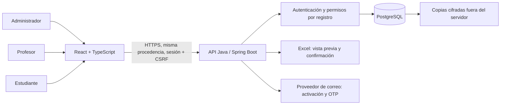

# Arquitectura de Centro Saber

Primera etapa para una academia de validación de bachillerato, cursos y programas técnicos con 50 a 200 estudiantes. El destino es acceso por internet; este entregable se ejecuta localmente.

React presenta formularios y tablas. Spring Boot valida cada operación y es el único componente que accede a PostgreSQL. Un monolito modular facilita aprender y mantener el proyecto sin sumar microservicios para este volumen.

La API se organizará por dominios: `security`, `students`, `teachers`, `courses`, `enrollments`, `grades`, `payments`, `imports`, `reports`, `portal`, `audit`. Cada dominio tendrá controladores con DTO, servicios transaccionales y repositorios parametrizados. Ningún controlador devuelve directamente entidades con contraseñas o información de otros usuarios.

En la etapa actual solo existe `/api/health`. Las demás rutas se rechazan en el servidor. No hay inicio de sesión, CRUD, envío de códigos ni importador operativo todavía. La interfaz inicial sirve plantillas vacías y una guía pública.

## Decisiones

- Java 21 y Spring Boot 3.5: versión de Java común entre desarrollo y producción. Requisito mínimo confirmado en la [documentación oficial](https://docs.spring.io/spring-boot/3.5/system-requirements.html).
- React y TypeScript con Vite: interfaz separada y verificación de tipos. Los requisitos de Node están en la [guía de Vite](https://vite.dev/guide/).
- PostgreSQL y Flyway: claves foráneas, restricciones y migraciones versionadas. No editar V1 después de aplicarla; añadir V2.
- UUID internos y códigos legibles en plantillas: la institución trabaja con códigos, mientras la API controla las relaciones internas.
- `ofertas_curso` representa curso + periodo + grupo. Las asignaciones docentes apuntan al grupo concreto, evitando dar acceso a todos los años de un curso.
- Notas y estado académico pertenecen a la matrícula. Escalas por evaluación: no se presupone una escala de 0 a 5.
- Cobros, pagos y reversiones se conservan. El saldo se calcula, no se importa como una cifra editable.
- Sesiones en cookie HttpOnly y CSRF, bajo la misma procedencia: simplifica la protección sin almacenar tokens en localStorage.

## Publicación futura

Servidor para Java y sitio React detrás de un proxy con HTTPS y `/api`. Base de datos privada, conexiones TLS verificadas y usuario de ejecución con permisos mínimos. Si se elige Supabase, conectar el backend a PostgreSQL; no entregar la contraseña de base de datos al navegador. Confirmar los límites y respaldos del proveedor antes de contratar o operar; no se ha creado una cuenta ni desplegado un sitio.

## Decisiones pendientes de la institución

Escalas y reglas de aprobación por programa; definición de mora; política de excedentes y devoluciones; moneda (las plantillas asumen COP); si habrá periodos que crucen años; si un estudiante puede tomar dos grupos del mismo curso; proveedor de correo y recuperación; conservación de datos y copias. No se calculará una finalización académica automática hasta definir sus requisitos.
