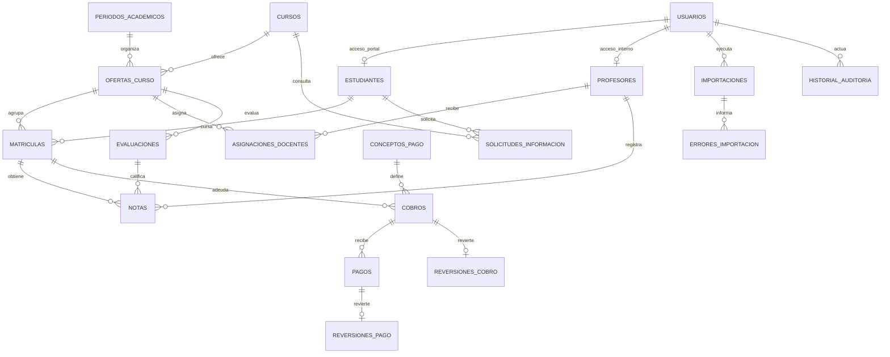

# Modelo de datos

El script ejecutable es `backend/src/main/resources/db/migration/V1__initial_schema.sql`. El diagrama resume las relaciones; las restricciones concretas están en la migración.

## Identificación e integridad

Documento = texto, nunca número: conservar ceros iniciales. Normalizar con Unicode NFKC, retirar espacios y separadores definidos, convertir letras a mayúscula y validar longitud. La combinación tipo + documento es única. No eliminar letras de pasaportes. Comprobar duplicados en el archivo y en base de datos; un mismo documento con nombres distintos requiere revisión, no actualización silenciosa.

Una matrícula pertenece a una oferta concreta. Sus notas solo pueden apuntar a evaluaciones y docentes asignados a esa misma oferta: las claves foráneas compuestas lo comprueban. La escala está delimitada por evaluación y un trigger valida el valor de cada nota. El rol del usuario vinculado y los periodos cerrados deberán verificarse en los servicios de la siguiente etapa.

## Estado académico

| Código | Etiqueta |
| --- | --- |
| EN_CURSO | En curso |
| FINALIZADO | Finalizado |
| NO_FINALIZADO | No finalizado |
| RETIRADO | Retirado |
| PENDIENTE_EVALUACION | Pendiente de evaluación |

No se borra un año para comenzar el siguiente. Se crea un periodo y nuevas ofertas/matrículas. Los registros anteriores conservan curso, resultados y movimientos.

## Dinero e historial

Valores en `numeric(14,2)`, sin cálculos de dinero en coma flotante. La vista `saldos_matricula` agrega primero cobros y pagos por matrícula; evita multiplicar totales al unir varios movimientos.

Solo pagos confirmados y no revertidos descuentan saldo. Una aprobación debe añadir el movimiento confirmado y revertir el movimiento en revisión dentro de una transacción, con nueva referencia vinculable y auditoría; los registros originales son inmutables. El servicio deberá impedir dobles aprobaciones y serializar operaciones sobre el mismo cobro. Esta lógica aún no está implementada.

Un cobro con pagos válidos no debe revertirse sin revertir o reasignar antes sus pagos: comprobarlo en el servicio financiero. No permitir exceso de abonos sin definir qué hacer con un saldo a favor. La vista expone un saldo negativo si hay datos inconsistentes, para no ocultarlo como cero.

Situación financiera futura: al día cuando saldo = 0; saldo pendiente cuando saldo > 0. `Pago parcial` describe abonos inferiores al cobro y `Pago en revisión` describe movimientos pendientes; pueden coexistir con un saldo. `En mora` requiere una política institucional. Los reportes deben permitir finalizar académicamente y mantener deuda.

## Auditoría y permisos de base de datos

Triggers bloquean UPDATE/DELETE de auditoría y movimientos. No equivalen a una defensa contra el propietario de la base de datos. En producción usar una cuenta de migración y otra de ejecución sin DDL, TRUNCATE, ni permisos de modificar auditoría. Cada operación sensible debe escribir un evento con actor y motivo dentro de la misma transacción. No registrar contraseñas, códigos temporales o copias completas de datos personales en logs.
